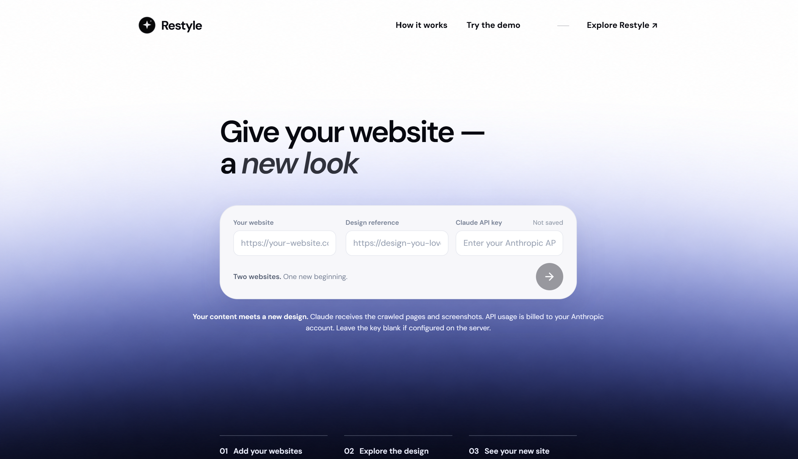

# Website Style Swap

> **Experimental prototype:** this is a proof of concept, not a finished product. Results may be incomplete, inaccurate, or unusable and must be reviewed before use.

Give your content a fresh look inspired by a website you love. Website Style Swap is a local experiment that brings together the content of one page and the visual direction of another, with help from Claude.



**Pick a source. Choose a reference. Explore the result.** The app captures the source page, studies the reference design, and generates an HTML/CSS draft you can preview and download. There is also a free, pre-generated demo to try without an API key, plus a standalone crawler for exploring multiple pages.

Built during [TRY & 2026](https://luma.com/tryand), an event hosted by ETH Student Project House and Oday Darwich in Zürich on 6–7 November 2026.

## Get started

You do not need a GitHub account or an API key to try the pre-generated demo. You do need a computer with an Internet connection and Python. Setup involves copying a few commands into a terminal; the app itself then opens in your web browser.

### 1. Download the project

1. At the top of this GitHub page, click the green **Code** button, then **Download ZIP**.
2. Find the downloaded ZIP file and extract it: on Windows, right-click it and choose **Extract All**; on macOS, double-click it.
3. Open the extracted `Website_Style_Swap-main` folder. It should contain `app.py` and `requirements.txt`. Keep the files together.

### 2. Install Python

Install [Python](https://www.python.org/downloads/) version 3.10 or newer if you do not already have it. On Windows, select **Add Python to PATH** if offered during installation. Close and reopen your terminal after installing it.

### 3. Open a terminal in the project folder

- **Windows:** in File Explorer, open the extracted folder, click the address bar, type `powershell`, and press Enter.
- **macOS:** open Terminal, type `cd` followed by a space, drag the extracted folder into the Terminal window, and press Enter.
- **Linux:** open a terminal in the extracted folder, for example by using your file manager's **Open in Terminal** option.

The terminal is a window where you can paste commands. Run the commands below one line at a time, pressing Enter after each and waiting for it to finish. The downloads may take a few minutes.

### 4. Install and start the app

**Windows (PowerShell):**

```powershell
py -m venv .venv
.\.venv\Scripts\python.exe -m pip install -r requirements.txt
.\.venv\Scripts\python.exe -m playwright install chromium
.\.venv\Scripts\python.exe app.py
```

**macOS / Linux:**

```bash
python3 -m venv .venv
.venv/bin/python -m pip install -r requirements.txt
.venv/bin/python -m playwright install chromium
.venv/bin/python app.py
```

After the final command, leave the terminal window open. Open <http://127.0.0.1:5050> in your browser. This address points to the app running on your own computer; it is not a public website. Do not open an HTML file directly.

### 5. Try the demo or create a draft

- **Try the demo:** select **Try the demo**, then **Free demo · Classy × ETH**. This displays a pre-generated example without an API key or paid AI calls.
- **Create a draft:** enter the URL of your source website and the URL of a design reference, then enter a valid **Anthropic API key** and click the arrow. You need an Anthropic API account and access to a compatible model. A Claude subscription does not necessarily include API access. API calls can be billed to your account; review the costs and data information below before generating.

You can preview and download the result when it is ready. To stop the app, return to the terminal and press **Ctrl+C**. To use it again later, reopen a terminal in the extracted folder and run only the final command from step 4.

If the page does not open, check that the terminal is still running and that you used `http://127.0.0.1:5050`. If a different or older local server is already using that address, stop it before starting this app. If a command fails, check that Python is installed and that the terminal is open in the folder containing `app.py`.

For advanced setup, the key can instead be set in the `ANTHROPIC_API_KEY` environment variable before starting the server. Never commit your key. Set `ANTHROPIC_MODEL` to select a model available to your account; the default model in the code must be available to you.

The standalone crawler is available at <http://127.0.0.1:5050/crawler> and does not require a Claude API key. Stop the server with `Ctrl+C`.

## How it works

1. Playwright visits the source page, saves its rendered HTML, and retrieves available images.
2. The application examines the reference and takes screenshots at different sizes.
3. Claude uses `docs/website_design_extraction_specification.md` to produce a design specification and an HTML/CSS page, then attempts a visual review.
4. The interface provides a preview and downloads. Results are stored locally in `transfers/` and crawls in `crawls/`.

| Path | Purpose |
| --- | --- |
| `app.py` | **Start here:** local Flask application and server |
| `requirements.txt` | Python dependencies |
| `static/` | Application interface and assets |
| `crawler.py`, `ai_transfer.py`, `transfer.py` | Crawler and generation code |
| `docs/` | Additional documentation, design specification, and example previews |
| `test_transfer_smoke.py` | Local smoke test with simulated Claude responses |

See [crawler documentation](docs/CRAWLER.md) and [Restyle documentation](docs/RESTYLE.md) for more detail.

## Costs, data, and limitations

Anthropic API calls may be billed to your account, and the application imposes no spending limit. Source content, observations, and reference screenshots are sent to Anthropic: do not use data you do not want to share. Only use websites and content you are authorized to access and use.

The generated page is a draft: text, images, links, layout, and accessibility may contain errors or omissions. Complex interactions, forms, and external services may not be reproduced. The preview blocks scripts in the generated page, and some website resources may be inaccessible. The application is intended for local use and should not be exposed to the Internet as-is.

## Disclaimer

This prototype is provided **as is**, without warranties of functionality, reliability, security, or fitness for a particular purpose. Users are responsible for reviewing results and complying with applicable rights and terms. To the extent permitted by applicable law, the authors disclaim liability for errors, losses, or direct or indirect damage arising from its use.

## Local test

From the repository root, run `python test_transfer_smoke.py` to test the pipeline with simulated Claude responses and no paid API call. This does not guarantee the quality of a real generation.
